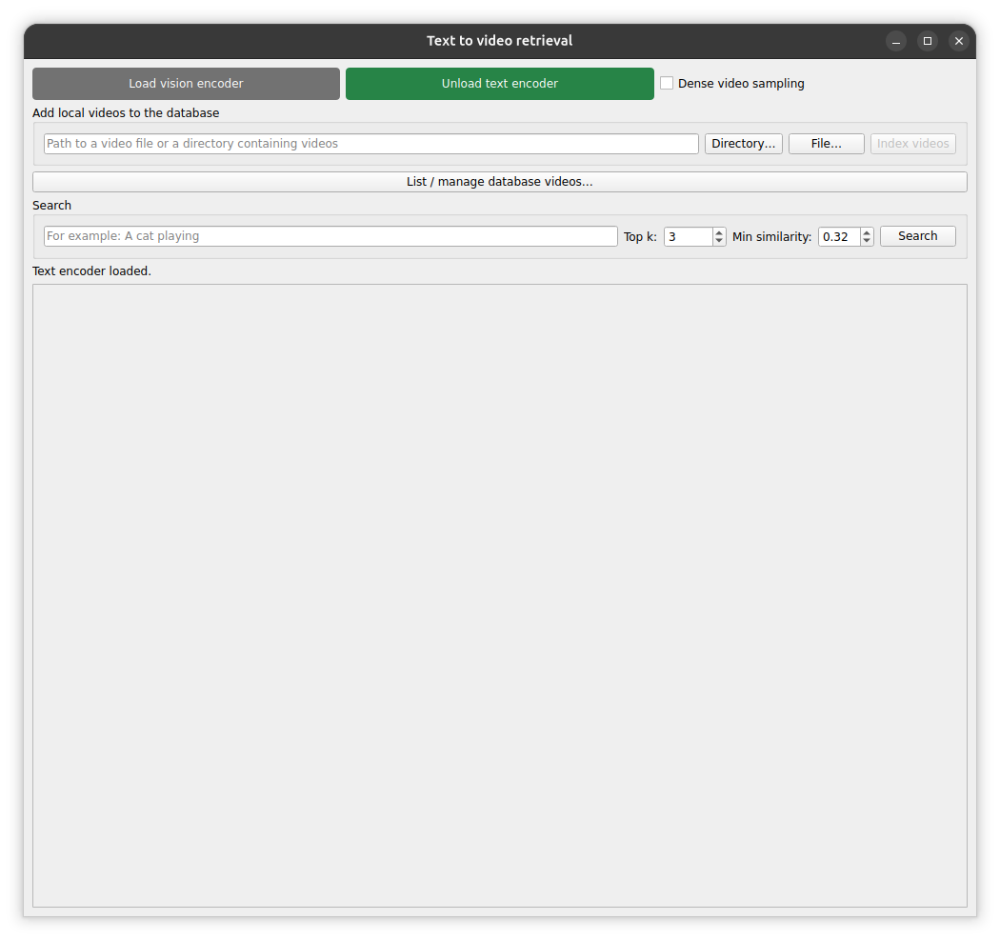

# text-video-retrieval

A desktop application for searching videos using natural-language queries.

The application uses InternVideo2's vision and text encoders to generate embeddings. Videos are ranked by the cosine similarity between their embeddings and the query embedding.



## Requirements

- A Linux host with access to an X11 display.
- An NVIDIA GPU with at least **6 GB of VRAM**.
- A compatible NVIDIA driver.
- Docker and the NVIDIA Container Toolkit.
- A PulseAudio-compatible audio server, such as PulseAudio or PipeWire with `pipewire-pulse`, if video playback with audio is required.

Install the NVIDIA Container Toolkit and configure it for Docker by following the [official installation guide](https://docs.nvidia.com/datacenter/cloud-native/container-toolkit/latest/install-guide.html).

> [!IMPORTANT]
> The published Docker image targets NVIDIA GPUs with compute capabilities **8.0, 8.6, 8.9, and 9.0**.
>
> Check your GPU's compute capability on the host:
>
> ```bash
> nvidia-smi --query-gpu=name,compute_cap --format=csv
> ```
>
> For other architectures, update `TORCH_CUDA_ARCH_LIST` in the `Dockerfile` and rebuild the image. The installed PyTorch, CUDA, and acceleration libraries must also support your GPU.

## Run

The application is distributed as a Docker image. Run the following commands on the host.

### 1. Allow access to the display

The launch instructions below assume the application runs as root inside the container.

```bash
xhost +si:localuser:root
```

### 2. Start the application

Replace `/absolute/path/to/videos` with an existing video directory on your host:

```bash
docker run --rm -d --gpus all \
    --env DISPLAY="$DISPLAY" \
    --mount type=bind,source=/tmp/.X11-unix,target=/tmp/.X11-unix \
    --mount type=volume,source=database-data,target=/text_video_retrieval/text_video_retrieval/data \
    --mount "type=bind,source=/absolute/path/to/videos,target=/workspace/videos,readonly" \
    --name text-video-retrieval \
    loreleva/text-video-retrieval
```

Your videos are available inside the application at **`/workspace/videos`**. Use this path, or a file path within it, when indexing videos.

The `database-data` volume stores the databases and persists after the container is stopped or removed. The mounted video directory is read-only.

### Optional: Enable audio

Check that the host's audio socket exists:

```bash
ls "$XDG_RUNTIME_DIR/pulse/native"
```

To enable audio, add the following options to the launch command **before the image name**:

```bash
--mount "type=bind,source=$XDG_RUNTIME_DIR/pulse/native,target=/tmp/pulse-native" \
--env PULSE_SERVER=unix:/tmp/pulse-native \
```

If the audio server requires cookie authentication and `$HOME/.config/pulse/cookie` exists on the host, also add:

```bash
--mount "type=bind,source=$HOME/.config/pulse/cookie,target=/tmp/pulse-cookie,readonly" \
--env PULSE_COOKIE=/tmp/pulse-cookie \
```

### 3. Revoke display access

After closing the application, revoke the display permission:

```bash
xhost -si:localuser:root
```

## Usage

### Index videos

1. Load the **vision encoder** using its button. It is unloaded by default.
2. Enter a video file or directory path inside the container, such as `/workspace/videos`.
3. Choose whether to enable **Dense video sampling**.
4. Click **Index videos** to generate embeddings and add the videos to the database.

By default, four frames are sampled uniformly from each video to create one clip and one video embedding.

With dense sampling enabled, one frame is sampled per second and the sampled frames are grouped into four-frame clips. Each clip embedding is normalized; the clip embeddings are then summed and normalized again to produce one embedding per video.

Dense sampling provides more temporal coverage but increases indexing time and may require more memory.

### Search videos

The **text encoder** is loaded automatically at startup.

1. Enter a natural-language query describing the videos you want to find.
2. Set the maximum number of results and the minimum cosine similarity.
3. Click **Search**.

Videos below the similarity threshold are excluded, so fewer than the requested number of results may be returned.

### Manage the database

Click **List / manage database videos...** to inspect and manage indexed videos.

Sparse and dense sampling use separate databases. Select the sampling mode corresponding to the videos you want to search.

## Troubleshooting

- **The application cannot access the GPU:** Check that `nvidia-smi` works on the host and that the NVIDIA Container Toolkit is configured for Docker.
- **The window does not open:** Check `DISPLAY`, the X11 socket mount, and the display permission.
- **Videos cannot be found:** Use paths inside the container, such as `/workspace/videos`, rather than the original host paths.
- **Previously indexed videos do not appear:** Check that the intended sampling mode is selected and that the same `database-data` volume is mounted.
- **Video playback has no audio:** Check the audio socket mount and authentication, and ensure playback is not muted.
- **The GPU runs out of memory during indexing:** Try sparse sampling or shorter videos.

## Acknowledgements

This application uses pretrained InternVideo2 model through
[a fork of the original repository](https://github.com/loreleva/InternVideo), adapted for
inference and integration with this desktop application.

The original models and research are provided by
[OpenGVLab/InternVideo](https://github.com/OpenGVLab/InternVideo).

**Paper:** Yi Wang et al.,
[InternVideo2: Scaling Foundation Models for Multimodal Video Understanding](https://arxiv.org/abs/2403.15377),
ECCV 2024.